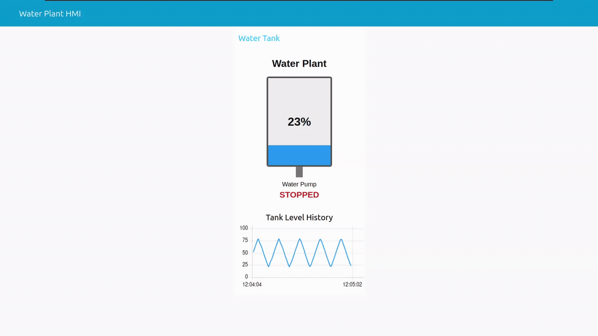
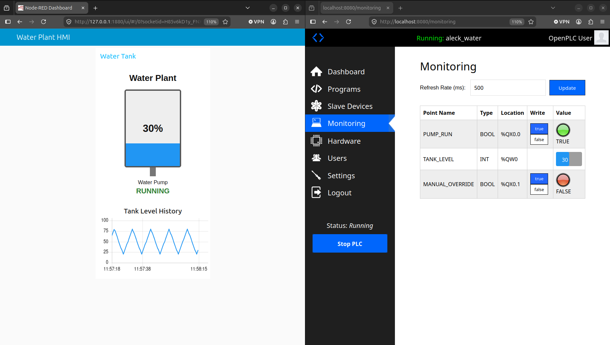
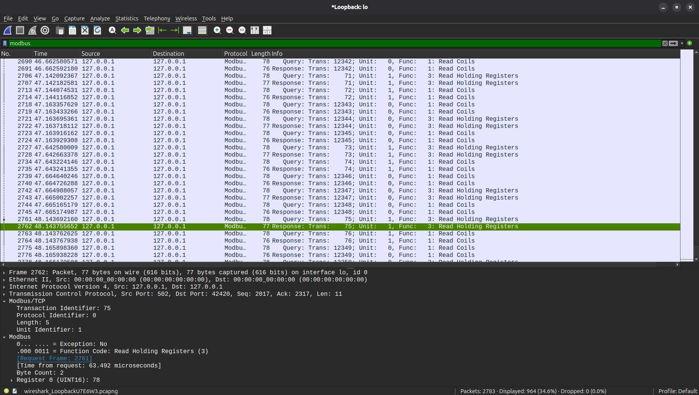
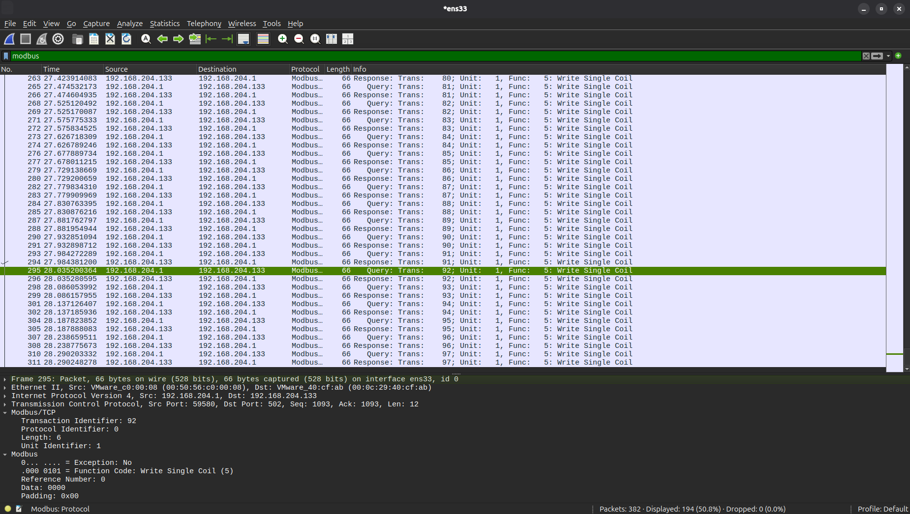
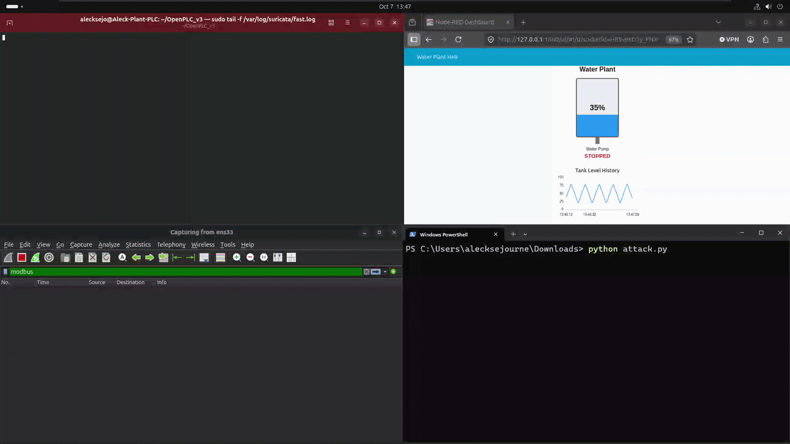
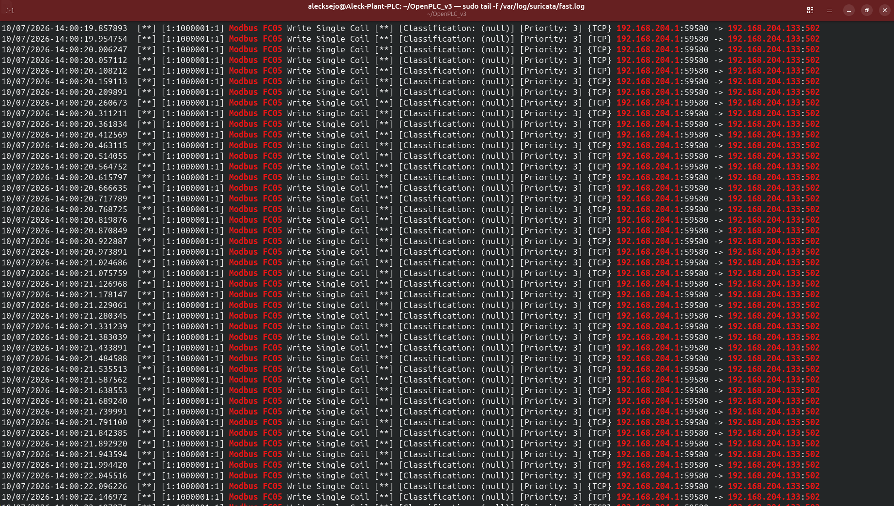
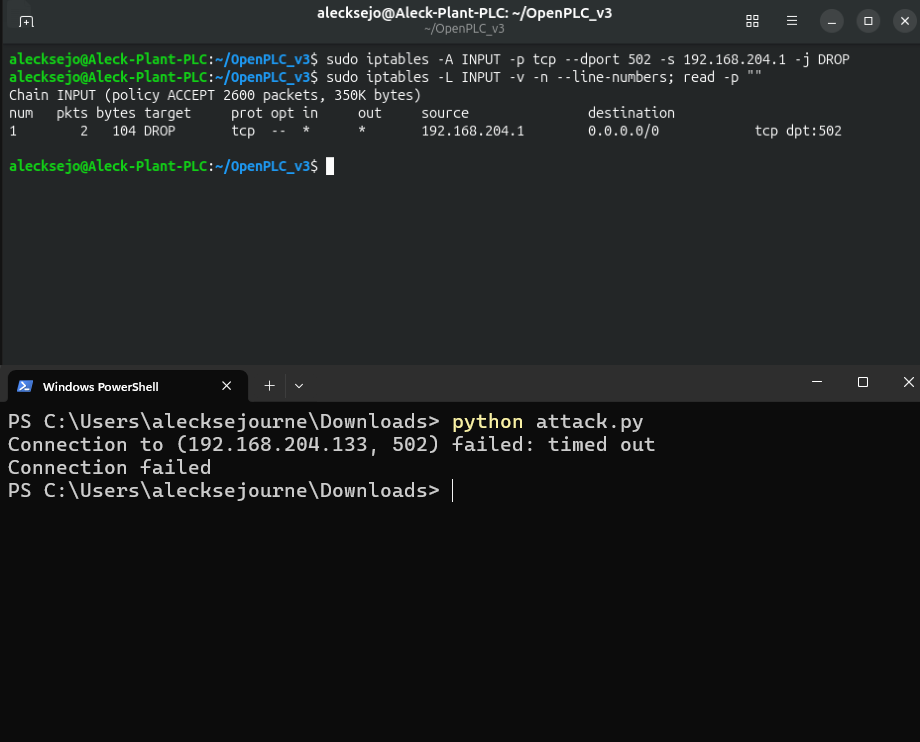

# OT/ICS Water Treatment Security Lab

Built this lab to get experience with OT networking and security. The lab uses OpenPLC to control a simulated water tank and pump, with Node-RED as the HMI.

I used the lab to look at normal Modbus TCP traffic, test a write to the PLC, detect that traffic with Suricata, and restrict access to the PLC with iptables.



## Lab Setup

The lab itself runs on Ubuntu in VMware. OpenPLC handles the PLC logic and Node-RED displays the tank level/pump status.

The process itself is simple. The tank level rises and falls, and the PLC turns the pump on or off based on the level. Node-RED then reads those values from OpenPLC with Modbus TCP and displays them on the HMI, providng an accurate tank level.

Also used a Python script from my Windows host to send Modbus traffic to OpenPLC over TCP port 502. Wireshark and Suricata ran on the Ubuntu OT VM so I could monitor the traffic.



## Normal Modbus Traffic

Intially started with Wireshark to see what the normal traffic looked like. The HMI regularly reads OpenPLC using FC01 (Read Coils) and FC03 (Read Holding Registers).

Since the HMI (Node-RED) and the PLC (OpenPLC) are on the same Ubuntu system, this traffic showed in the Wireshark loopback interface (`127.0.0.1`). In the picture below, FC03 is reading the register used for the tank level.



Full capture (Wireshark PCAP): [`pcaps/normal-modbus.pcapng`](pcaps/normal-modbus.pcapng)

## Modbus Write Test

I used a Python script with PyModbus to send FC05 (Write Single Coil) commands to Coil 0, which controls the pump in my PLC program.

The script repeatedly writes OFF to the pump coil for a few seconds, simulating an unauthorized command that disrupts the water plant process. The PLC continues running its own logic during the test, so it keeps trying to update the pump while the script forces it back OFF. This caused the pump state to change back and forth while the script was running.

I was able to see the FC05 requests in Wireshark going to OpenPLC on TCP port 502, as seen in the picture below.



The GIF below shows the write test while I was monitoring the HMI, network traffic, and Suricata.



Script: [`scripts/poverride.py`](scripts/poverride.py)  
Wireshark PCAP: [`pcaps/attack-modbus.pcapng`](pcaps/attack-modbus.pcapng)

## Detection

I wanted Suricata to alert when this type of write was sent to the PLC, so I created a rule for FC05 traffic going to Modbus TCP port 502.

I used/referenced the Modbus protocol specification to understand the request format and where the FC05 function code appears in the packet.

```text
alert tcp any any -> any 502 (msg:"Modbus FC05 Write Single Coil"; flow:to_server,established; content:"|00 00|"; offset:2; depth:2; content:"|05|"; offset:7; depth:1; sid:1000001; rev:1;)
```

Running the Python script triggered the Suricata rule and generated the alerts below.



Rule: [`suricata/local.rules`](suricata/local.rules)

## Restricting Access

Suricata was now detecting the Modbus commands, but my Windows host could still connect to the PLC.

I was able to use iptables to block my external Windows host from reaching Modbus TCP port 502.

```
sudo iptables -A INPUT -p tcp -s <TEST_SOURCE_IP> --dport 502 -j DROP
```

I ran the same script again and the connection timed out. The local HMI and PLC continued communicating normally through the loopback interface, preventing further unauthorized Modbus commands from reaching the PLC



## What I Learned

I learned a lot throughout the lab, but the PLC scan cycle was one of the more interesting things for me. Writing OFF to the pump did not simply leave it off. The PLC kept running its own logic and updating the same output, which made it seem like the PLC and my script were almost fighting over the pump state. Seeing that happen really helped me understand how an unauthorized command could disrupt a real control process, even when the PLC itself is still running normally.

Seeing the Modbus traffic in Wireshark allowed me to better understand function codes. I was able to see the difference between the normal FC01 and FC03 reads and the FC05 writes used during the test.

Another thing I learned was how packet analysis and detection can work together. I was able to take the FC05 traffic I first found manually in Wireshark and create a Suricata rule to detect it automatically. I also saw the difference between detection and prevention. Suricata could alert me to the traffic, but it did not stop it. Using iptables to restrict access to port 502 prevented the same Modbus commands from reaching the PLC.

## References

- [Modbus Application Protocol Specification V1.1b](https://www.modbus.org/file/secure/modbusprotocolspecification.pdf)
- [Suricata User Guide documentation](https://docs.suricata.io/en/latest/)

*AI was used as a technical assistant for parts of the lab setup, PLC/HMI configuration, and some scripting. I configured, tested, and verified the lab myself.*
